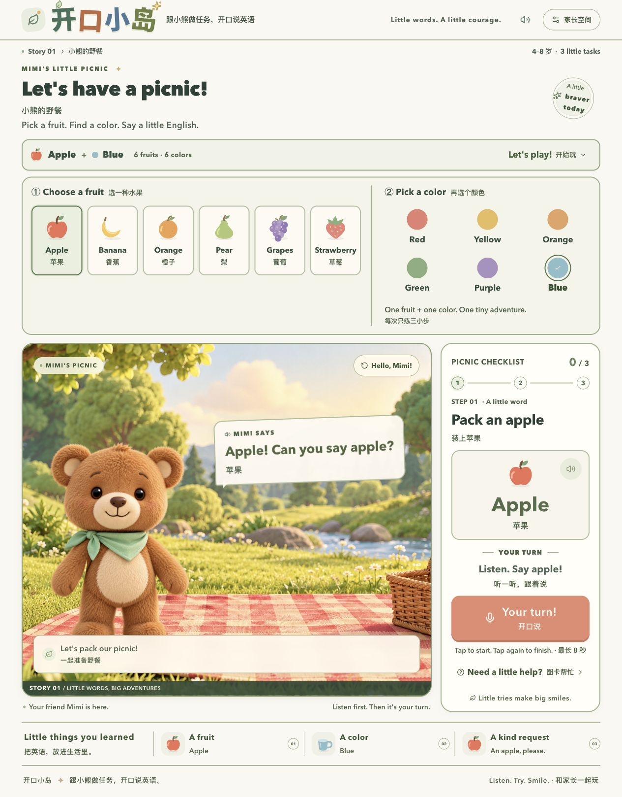

# 开口小岛 · Speaking Island

**跟小熊做任务，开口说英语。**



面向幼儿园与小学低年级的英语启蒙互动应用。第一关是「小熊的野餐」：孩子选一种水果和一种颜色，跟着会动的小熊听示范、说单词、练习礼貌表达，一起准备野餐。

这是一个独立项目，不依赖其他英语点读网站，也不需要本地部署模型。语音请求由服务端代理调用蚂蚁百灵 Ming 在线 API。

## 可以玩什么

- **6 种水果**：apple、banana、orange、pear、grapes、strawberry。
- **6 种颜色**：red、yellow、orange、green、purple、blue。两类独立单选，换水果不会替你换颜色。
- **每轮 3 步**：说水果 → 说杯子的颜色 → 说 “A pear, please.” 这类简单请求。共 36 种组合。
- **绘本动效**：小熊挥手、眨眼、倾听和庆祝；大字单词、大按钮，手机也能练习。
- **英语为主，中文辅助**：英文示范 → 简短中文词义 → 英文再示范。
- **图卡帮助**：不方便录音时可以点图卡。图卡完成与语音完成分别统计。
- **家长空间**：录音授权、固定样例连接检测、本次真实识别记录和 JSON 导出、本机进度清除。

## 三个模型如何配合

| 能力 | 请求中的模型 ID | 作用 |
| --- | --- | --- |
| 语音识别 | `Ming-3.0-asr-tiny` | 将孩子的短录音转成英文文本 |
| 音频理解 | `Ming-3.0-audio-flash` | 听原始音频，判断是否完成当前表达任务 |
| 语音合成 | `Ming-3.0-tts` | 生成小熊的固定英文引导与回应 |

代码使用官方 `https://api.ant-ling.com/v1` 接口，分别调用 `/audio/transcriptions`、`/chat/completions`、`/audio/speech`。请求中的模型别名与模型权重名称可能不同；以账号实际权限和官方文档为准。本仓库不包含模型权重。

英文固定配音已经生成，位于 `public/media/voice/v2/`，文本和模型信息在同目录的 `manifest.json`。普通播放先使用这些素材，缺失时才调用在线 TTS。当前播放速度为 0.9 倍。中文短提示使用浏览器已有的中文系统语音，不计为 Ming 输出；没有中文音色时显示文字。

## 本地启动

需要 **Node.js 22.13 或更新版本**、npm。建议使用 Node.js 22 LTS。

```bash
npm ci
cp .env.example .env.local
npm run dev
```

打开 [http://127.0.0.1:3000](http://127.0.0.1:3000)。不填密钥也能体验场景、固定英文配音和图卡流程。

要开启真实识别，在 `.env.local` 的 `MING_API_KEY` 后填写你自己的百灵密钥，再重启服务。密钥可在 [Ling Studio](https://ling.tbox.cn) 获取，账号需具备上述模型的 API 权限。不要将它写进前端、截图或 Git。`.env.local` 已加入忽略规则。

本地开发默认只监听 `127.0.0.1`，无需家长访问口令。如果设置了 `APP_PASSWORD`，浏览器会要求 HTTP Basic 登录，用户名为 `parent`。

## 验证在线语音

1. 配置自己的密钥并启动应用。
2. 打开「家长空间」，点击「用示例音频检测连接」。它使用仓库内合成的 “A pear, please.”，不开启麦克风、不计入练习成绩；会产生真实 API 请求。
3. 检查真实转写与理解服务状态。仅「已配置」不代表提供方调用一定成功。
4. 监护人同意后，点击麦克风录音，说完再点一次，最长 8 秒。
5. 在家长空间回听最近录音、查看真实结果，按需导出 JSON。

浏览器录音需要 HTTPS 或 localhost 安全上下文，并获得麦克风权限。提供方限流或异常会显示提示；音频理解失败时保留真实 ASR 转写，退回固定任务规则，并在结果中标记 `decisionSource: "asr_rules"`。

## 运行与部署

```bash
npm test
npm run typecheck
npm run build
npm run test:smoke
npm start
```

生产环境必须在服务端设置 `MING_API_KEY` 和 `APP_PASSWORD`，才会开放在线语音。浏览器访问口令的固定用户名是 `parent`。缺少 `APP_PASSWORD` 时，生产页面仍可体验图卡和缓存配音，付费语音代理保持关闭。

`npm start` 默认只监听本机，适合放在 HTTPS 反向代理后。容器或托管平台需要监听所有网卡时，使用：

```bash
npx next start --hostname 0.0.0.0 --port 3000
```

更多配置见 [部署说明](docs/DEPLOYMENT.md)。GitHub Actions 只做检查和构建，不部署、不发布。

## 数据与能力边界

- 麦克风由监护人确认后才开启。每次音频在浏览器编码为 16 kHz、单声道、16 bit PCM WAV，经应用服务端转给百灵。
- 应用代码不将录音、转写或识别结果写入服务器文件或数据库。最近录音和最近 30 条识别记录仅在当前页面内存里；刷新或清除后移除。基础设施日志与第三方处理规则见 [隐私与数据流](docs/PRIVACY.md)。
- 本机 `localStorage` 只保存水果、颜色和每个组合的任务进度。主动导出的文件会留在下载位置，由家长自行管理。
- 反馈表示**表达内容是否完成任务**，不提供音素、口音或发音准确率评分。`pear/pair` 同音转写按水果语境处理，允许正确表达重复跟读。
- 小熊使用浏览器分层动画，说话状态跟随音频播放；没有生成故事视频，也没有音素级口型同步。
- 连接检测样例与仓库配音均为合成音频。项目没有提供真实儿童测试数据或学习效果结论。

## 项目结构

```text
app/                 页面、样式与服务端语音路由
components/          小熊场景、图形与家长空间
lib/                 任务目录、录音编码、Ming 代理与访问校验
public/              绘本素材、字体、固定合成配音
proxy.ts             独立部署的家长口令入口
scripts/             发布文件白名单与敏感信息检查
tests/              内容任务与访问边界测试
docs/               架构、部署与隐私说明
.github/             CI、Issue 与 PR 模板
```

技术栈：Next.js App Router、React、TypeScript、Tailwind CSS。开发和构建使用 Webpack。没有数据库依赖。

`npm run test:smoke` 需要先完成构建，会启动临时本机服务检查主页、素材与访问边界；它清空测试进程的真实密钥，不调用百灵，也不消耗模型额度。

## 参与与许可

代码采用 [MIT 许可证](LICENSE)。字体保留 SIL OFL 1.1；素材与依赖来源见 [第三方说明](THIRD_PARTY_NOTICES.md)。欢迎按 [贡献指南](CONTRIBUTING.md) 提交改进；安全问题见 [SECURITY.md](SECURITY.md)。

运行 `npm run check:release` 可检查发布白名单中的疑似密钥、内部部署标识和本地绝对路径。发布时只应包含白名单文件，不包含 `.env.local`、历史录音、构建产物或 Git 历史。
