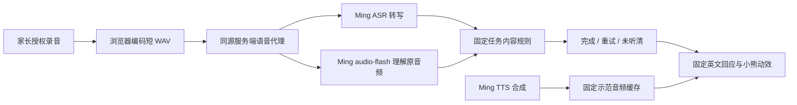

# 架构与任务判断

## 浏览器

`app/page.tsx` 管理选项、三步任务、当前录音、播放与进度。水果和颜色各自独立单选。正在录音或等待结果时禁止切换；切换任务会取消旧活动，避免旧请求推进新任务。

`lib/recorder.ts` 请求麦克风，将音频重采样到 16 kHz 单声道 WAV；最长 8 秒。录制结束、取消或离开页面后会关闭音轨。没有后台录音。

`components/picnic-art.tsx` 和 CSS 将小熊拆成图层。播放状态触发嘴部与身体动作，倾听、思考、成功各有状态。这是绘本动效，不是生成视频。

## 服务端

`lib/ming-server.ts` 从服务端环境读取 `MING_API_KEY`。模型与提供方地址固定，浏览器不能传入自定义模型、目标 URL 或系统提示词。

- `GET /api/voice/status`：只返回配置是否存在、访问状态和模型名称，不调用提供方，不返回密钥。
- `POST /api/voice/listen`：需要访问许可、同源请求、监护人确认字段、已知任务、合法 0.35–8.5 秒 PCM WAV。调用识别与原音频理解后返回任务证据 JSON。
- `POST /api/voice/speak`：只接受 `lib/lesson.ts` 中的固定 `phrase` ID；不能任意合成文本。优先播放已有缓存，缺失时才请求此接口。

提供方请求超时为每次 40 秒；识别和理解是两个顺序请求。异常只记录接口路径和状态码，不把提供方错误正文、授权头或音频写入应用日志。

## 判断与降级

任务规则在 `lib/lesson.ts`：单词任务需要目标内容；颜色任务接受颜色或颜色加 cup；礼貌请求必须包含指定水果与 please。允许同一正确表达重复最多四遍；错误水果、否定、额外指令不会因重复而被清除。

理解返回时，完成任务需要 ASR 文本、理解结果以及理解中实际听到的词同时满足规则；静音或空转写不会根据题目猜成成功。理解服务失败时使用真实转写和固定规则，明确标记 `asr_rules`。这是任务内容判断，不是发音准确率评测。

`VoiceEvidence` 包含转写、任务、结果、模型、实际耗时和 `decisionSource`。它只保留在当前浏览器页面，除非家长主动下载。

## 独立部署访问

开源版使用 Node.js 服务端环境变量，移除了托管平台专用的身份与部署绑定。`proxy.ts` 在配置 `APP_PASSWORD` 后以 HTTP Basic 保护主页及语音接口，用户名 `parent`；路由内部也检查访问状态。反向代理可设置 `APP_ORIGIN` 明确指定浏览器页面源，服务端不依赖任意转发头放宽同源校验。

无口令时仅允许本机开发调用在线 API；生产模式保持语音关闭。限流是**单个进程共享的每分钟 20 次语音请求**，重启后重置。它适合家庭演示，不是多租户账号或分布式配额系统。扩展公共服务时应替换共享口令和内存限流。
